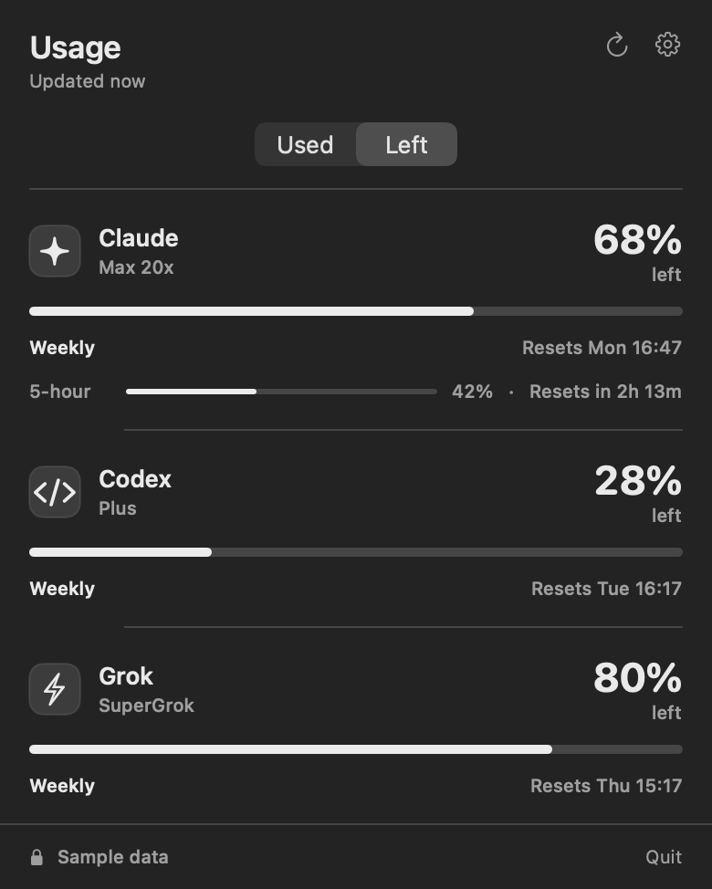

# Agent Usage

[](https://github.com/PAAparaschivei/agent-usage/actions/workflows/ci.yml)

See the capacity left in your AI subscriptions from the macOS menu bar. Click the menu bar item for usage windows and reset times. Switch between percentage used and percentage left in the popover.



## Build and run

Requires macOS 14 or later, Xcode 26 and [XcodeGen](https://github.com/yonaskolb/XcodeGen).

```sh
git clone https://github.com/PAAparaschivei/agent-usage.git
cd agent-usage
./scripts/package-app.sh
open "dist/Agent Usage.app"
```

The script builds an ad-hoc signed app for this Mac. You can move it to Applications after quitting it. Open at login and limit alerts are available in Settings. This release is a menu bar app.

To try it with sample data and no provider setup, quit the app and run:

```sh
"./dist/Agent Usage.app/Contents/MacOS/Agent Usage" --demo
```

## Connect your tools

| Provider | Setup | Data source |
| --- | --- | --- |
| Codex | Install the Codex CLI and sign in through the CLI | Account rate limits from the CLI's app server over standard input and output |
| Claude | Add the supplied helper to your Claude Code status line | Five-hour and weekly limits when Claude Code includes them |
| Grok | Enable **Read Grok billing log** in Settings | Most recent compatible billing event from the local Grok CLI log. This integration is experimental. |

Codex is discovered in `~/.local/bin`, `/opt/homebrew/bin` or `/usr/local/bin`. Its CLI can contact OpenAI to read account limits. The app sends no inference requests.

### Claude Code status line

After moving the app to `/Applications`, add this `statusLine` entry to your existing `~/.claude/settings.json`. If you already have a status line, pipe the same input to this helper from your script and keep your current display command. The helper's stdout is its own display text, so redirect it to `/dev/null` when composing it with another script.

```json
{
  "statusLine": {
    "type": "command",
    "command": "\"/Applications/Agent Usage.app/Contents/Helpers/agent-usage-claude-capture\""
  }
}
```

Run Claude Code normally. Its status line exposes subscription rate limits for eligible plans after the first response in a session. Open Agent Usage and refresh once the status line has run. See the [Claude Code status line reference](https://code.claude.com/docs/en/statusline#available-data).

## Data and troubleshooting

Agent Usage keeps its latest normalized snapshot in `~/Library/Application Support/Agent Usage Menu Bar/usage-snapshot.json`. The Claude helper writes only timestamps and quota windows to `~/.claude/agent-usage-status.json`. Grok support reads billing records from `~/.grok/logs/unified.jsonl` when enabled. The app has no telemetry and does not open transcripts or provider credential files.

A dash means the app has no current reading for that provider. Snapshots age out after 15 minutes and expired windows stop showing a current percentage. Refresh from the popover. For Claude and Grok, the source CLI must write a new observation before a stale value can update. Provider output can change across CLI versions.

To uninstall, turn off **Open at login**, quit the app and remove it. Remove the Claude status line entry or helper call if you added one.

## Development

```sh
xcodegen generate
xcodebuild -project AgentUsage.xcodeproj -scheme AgentUsage -destination 'platform=macOS' test CODE_SIGNING_ALLOWED=NO
./scripts/package-app.sh
./scripts/check-claude-capture.sh
```

CI uses synthetic provider data and runs without signing into an account. For issues, include your macOS version, provider CLI version and the displayed status. Use synthetic examples for logs and configuration.

[Apache License 2.0](LICENSE).
